<!-- repo-map:no-verification -->
<!-- GENERATED FILE -- do not edit by hand.
     Regenerate with `repo-tools map`. -->

# @danielsimonjr/repo-tools - Dependency Graph

**Version**: 2.3.0

This document provides a comprehensive dependency graph of all files, components, imports, functions, and variables in the codebase.

---

## Table of Contents

1. [Overview](#overview)
2. [Package Dependencies](#package-dependencies)
3. [Root Dependencies](#root-dependencies)
4. [Check Dependencies](#check-dependencies)
5. [Chunk Dependencies](#chunk-dependencies)
6. [Clones Dependencies](#clones-dependencies)
7. [Compress Dependencies](#compress-dependencies)
8. [Depgraph Dependencies](#depgraph-dependencies)
9. [Docs Dependencies](#docs-dependencies)
10. [Map Dependencies](#map-dependencies)
11. [Query Dependencies](#query-dependencies)
12. [Ste Dependencies](#ste-dependencies)
13. [Dependency Matrix](#dependency-matrix)
14. [Circular Dependency Analysis](#circular-dependency-analysis)
15. [Visual Dependency Graph](#visual-dependency-graph)
16. [Summary Statistics](#summary-statistics)

---

<a id="overview"></a>
## Overview

The codebase is organized into the following modules:

- **root**: 9 files
- **check**: 4 files
- **chunk**: 3 files
- **clones**: 6 files
- **compress**: 3 files
- **depgraph**: 22 files
- **docs**: 9 files
- **map**: 18 files
- **query**: 6 files
- **ste**: 5 files

---

<a id="root-dependencies"></a>

## Root Dependencies

### `src/assets.d.ts` - assets.d module

**Exports:**
- Default: `default`

---

### `src/bin.ts` - bin module

**Internal Dependencies:**
| File | Imports | Type |
|------|---------|------|
| `./cli.ts` | `main` | Import |

---

### `src/cli.ts` - Command-line dispatch for `repo-tools` (design section 3).

**Internal Dependencies:**
| File | Imports | Type |
|------|---------|------|
| `./check/index.ts` | `CHECK_HELP, run` | Import |
| `./chunk/index.ts` | `CHUNK_HELP, run` | Import |
| `./clones/index.ts` | `CLONES_HELP, run` | Import |
| `./compress/index.ts` | `HELP, run` | Import |
| `./docs/index.ts` | `DOCS_HELP, run` | Import |
| `./io-types.ts` | `Io` | Import (type-only) |
| `./map/command.ts` | `DEPGRAPH_DEPRECATION, MAP_HELP, runMap` | Import |
| `./query/index.ts` | `QUERY_HELP, run` | Import |
| `./ste/index.ts` | `run, STE_HELP` | Import |
| `./io-types.ts` | `Io` | Re-export (type-only) |

**Exports:**
- Types: `SubcommandName`
- Functions: `main`
- Constants: `SUBCOMMANDS`
- Re-exports: `Io`

---

### `src/config.ts` - The config file `repo-tools.config.json` (design section 5) and the merge of the command-line

**Node.js Built-in Dependencies:**
| Module | Import |
|--------|--------|
| `fs` | `existsSync, readFileSync` |
| `path` | `posix, resolve, win32` |

**Internal Dependencies:**
| File | Imports | Type |
|------|---------|------|
| `./depgraph/api-surface.ts` | `DEFAULT_STABILITY_TAGS` | Import |
| `./depgraph/duplicates.ts` | `DEFAULT_DISPATCH_CALLS` | Import |
| `./depgraph/exclude.ts` | `DEFAULT_EXCLUDE, TEST_DIR_NAMES` | Import |
| `./depgraph/paths.ts` | `OUTPUT_SUBDIR` | Import |
| `./depgraph/reporters/banner.ts` | `DEFAULT_REGENERATE_COMMAND, VERIFICATION_MARKER` | Import |

**Exports:**
- Interfaces: `ApiSurfaceConfig`, `DepgraphConfig`, `QuerySettings`, `QueryConfig`, `ClonesSettings`, `ConfigSections`
- Types: `DepgraphSettings`
- Functions:

  ```text
  isAbsolutePath, resolveUnderRoot, checkClonesFlag, parseConfigSections, parseConfig,
  loadConfigSections, loadConfigFile, mergeQueryConfig, mergeMapConfig, mergeDepgraphConfig
  ```

- Constants: `CONFIG_FILE`, `DEFAULT_API_ENTRY`, `ABSOLUTE_PATH_TEXT`, `MAP_REGENERATE_COMMAND`

---

### `src/io-types.ts` - Shared types for command output. Subcommand modules import `Io` from here, so they do not

**Exports:**
- Interfaces: `Io`

---

### `src/io.ts` - Deterministic file output. Every file that repo-tools writes has LF line endings, so two

**Node.js Built-in Dependencies:**
| Module | Import |
|--------|--------|
| `fs` | `lstatSync, mkdirSync, realpathSync, writeFileSync` |
| `path` | `basename, dirname, join, resolve` |

**Exports:**
- Functions: `writeLf`, `withOneLf`, `writeReport`, `toJson`, `realPath`

---

### `src/mask.ts` - The one comment and string masking module of repo-tools.

**Exports:**
- Functions: `blankCommentsAndStrings`, `stripComments`

---

### `src/py.ts` - The Python string behaviour that the ported Python tools (STE, map) depend on.

**Exports:**
- Functions:

  ```text
  ci, pyStrip, pyLstrip, pySplit, pySplitlines, isAlnum, headCodePoints, codePointLength, pyRepr,
  reEscape, pyDirname, pyJoin, pyNormpath
  ```

- Constants: `SPACE_BODY`, `S`, `NON_SPACE`, `W`, `B`, `D`

---

### `src/sort.ts` - Code-unit ordering (design fix F22).

**Exports:**
- Functions: `compareCodeUnits`, `sortCodeUnits`

---

<a id="check-dependencies"></a>

## Check Dependencies

### `src/check/claims.ts` - The claims of a document (design section 15): the rows of its `## Verification` table.

**Internal Dependencies:**
| File | Imports | Type |
|------|---------|------|
| `../depgraph/reporters/banner.ts` | `VERIFICATION_MARKER` | Import |

**Exports:**
- Interfaces: `Claim`, `Scan`
- Functions: `scanVerification`, `parseClaims`, `hasVerificationSection`
- Constants: `NO_VERIFICATION_MARKER`

---

### `src/check/index.ts` - `repo-tools check` (design section 15): the drift gate. It reads the Verification tables of

**Node.js Built-in Dependencies:**
| Module | Import |
|--------|--------|
| `fs` | `readdirSync, readFileSync` |
| `path` | `join, resolve` |

**Internal Dependencies:**
| File | Imports | Type |
|------|---------|------|
| `../config.ts` | `ABSOLUTE_PATH_TEXT, isAbsolutePath, loadConfigFile, mergeMapConfig` | Import |
| `../depgraph/args.ts` | `wantsHelp` | Import |
| `../depgraph/paths.ts` | `maskRoot` | Import |
| `../io-types.ts` | `Io` | Import (type-only) |
| `../map/command.ts` | `isDirectory` | Import |
| `../sort.ts` | `sortCodeUnits` | Import |
| `./claims.ts` | `NO_VERIFICATION_MARKER` | Import |
| `./metrics.ts` | `collectMetrics` | Import |
| `./verify.ts` | `DocFile, Verdict, verifyDocs` | Import |

**Exports:**
- Functions: `run`
- Constants: `CHECK_HELP`

---

### `src/check/metrics.ts` - The metrics of `repo-tools check` (design section 15): the claim names that a document can

**Node.js Built-in Dependencies:**
| Module | Import |
|--------|--------|
| `fs` | `mkdtempSync, readFileSync, rmSync` |
| `os` | `tmpdir` |
| `path` | `join` |

**Internal Dependencies:**
| File | Imports | Type |
|------|---------|------|
| `../map/artifacts.ts` | `emitDependencyGraph, emitDuplicateSymbols, emitFileInventory, emitUnusedAnalysis` | Import |
| `../map/command.ts` | `graphOf` | Import |
| `./verify.ts` | `Measured, MetricValue` | Import (type-only) |

**Exports:**
- Interfaces: `MetricsOptions`
- Functions: `collectMetrics`

---

### `src/check/verify.ts` - The verdict of `repo-tools check` (design section 15): each claim of each document against

**Internal Dependencies:**
| File | Imports | Type |
|------|---------|------|
| `./claims.ts` | `NO_VERIFICATION_MARKER, parseClaims, scanVerification` | Import |

**Exports:**
- Interfaces: `Measured`, `DocFile`, `Verdict`
- Types: `MetricValue`
- Functions: `verifyDocs`

---

<a id="chunk-dependencies"></a>

## Chunk Dependencies

### `src/chunk/index.ts` - `repo-tools chunk` (design section 8): split a large file into chunk files, merge

**Node.js Built-in Dependencies:**
| Module | Import |
|--------|--------|
| `fs` | `copyFileSync, existsSync, lstatSync, readFileSync, realpathSync, statSync, writeFileSync` |
| `path` | `basename, dirname, extname, isAbsolute, join, relative, resolve, sep` |

**Internal Dependencies:**
| File | Imports | Type |
|------|---------|------|
| `../io.ts` | `realPath, writeLf` | Import |
| `../io-types.ts` | `Io` | Import (type-only) |
| `./manifest.ts` | `ChunkInfo, contentHash, FileType, hashFor, isAbsoluteAnywhere, MANIFEST_NAME, MANIFEST_VERSION, Manifest, readManifest, relativeSource, resolveSource, writeManifest` | Import |
| `./splitters.ts` | `chunkFilename, detectFileType, detectLineEnding, JsonSplit, lineBreakRuns, mergeJson, mergeJsonLayout, normalizeLineEndings, restoreLineBreaks, splitJson, splitMarkdown, splitTypeScript` | Import |

**Exports:**
- Functions: `run`
- Constants: `CHUNK_HELP`

---

### `src/chunk/manifest.ts` - The chunk manifest: its types, its hash and its file I/O (design section 8).

**Node.js Built-in Dependencies:**
| Module | Import |
|--------|--------|
| `crypto` | `createHash` |
| `fs` | `readFileSync` |
| `path` | `posix, relative, resolve, sep, win32` |

**Internal Dependencies:**
| File | Imports | Type |
|------|---------|------|
| `../io.ts` | `toJson, writeLf` | Import |
| `./splitters.ts` | `JsonLayout, LINE_BREAK_RUNS` | Import |

**Exports:**
- Interfaces: `ChunkInfo`, `Manifest`
- Types: `FileType`
- Functions:

  ```text
  contentHash, legacyHash, hashFor, relativeSource, resolveSource, readManifest, isPlainFileName,
  isAbsoluteAnywhere, validateManifest, writeManifest
  ```

- Constants: `MANIFEST_VERSION`, `MANIFEST_NAME`

---

### `src/chunk/splitters.ts` - Splitters for the `chunk` subcommand (design section 8): Markdown, JSON and TypeScript.

**Node.js Built-in Dependencies:**
| Module | Import |
|--------|--------|
| `path` | `extname` |

**Internal Dependencies:**
| File | Imports | Type |
|------|---------|------|
| `./manifest.ts` | `FileType` | Import (type-only) |

**Exports:**
- Interfaces: `Section`, `JsonLayout`, `JsonSplit`
- Functions:

  ```text
  normalizeLineEndings, detectLineEnding, lineBreakRuns, restoreLineBreaks, detectFileType,
  chunkExtension, chunkFilename, splitMarkdown, splitJson, mergeJsonLayout, mergeJson, splitTypeScript
  ```

- Constants: `LINE_BREAK_RUNS`

---

<a id="clones-dependencies"></a>

## Clones Dependencies

### `src/clones/detect.ts` - The clone detector (design section 17.6) finds exact groups.

**Internal Dependencies:**
| File | Imports | Type |
|------|---------|------|
| `./units.ts` | `Unit` | Import (type-only) |

**Exports:**
- Interfaces: `DetectParams`, `NearPair`, `Detection`
- Functions: `detect`

---

### `src/clones/index.ts` - `repo-tools clones` (design section 17): lists the functions of a repository and finds the

**Node.js Built-in Dependencies:**
| Module | Import |
|--------|--------|
| `path` | `join, resolve` |

**Internal Dependencies:**
| File | Imports | Type |
|------|---------|------|
| `../config.ts` | `ClonesSettings, checkClonesFlag, loadConfigSections` | Import |
| `../depgraph/paths.ts` | `maskRoot` | Import |
| `../io.ts` | `writeLf` | Import |
| `../io-types.ts` | `Io` | Import (type-only) |
| `../map/command.ts` | `isDirectory` | Import |
| `../map/discovery.ts` | `discover, readSource` | Import |
| `../map/grammars.ts` | `grammarFor, loadGrammar, parserFor` | Import |
| `./detect.ts` | `detect` | Import |
| `./report.ts` | `clonesJson, inventoryJsonl, summaryText` | Import |
| `./settings.ts` | `ClonesConfig, mergeClonesConfig` | Import |
| `./units.ts` | `Unit, unitsOf` | Import |

**Exports:**
- Functions: `run`
- Constants: `CLONES_HELP`

---

### `src/clones/normalise.ts` - The normal form of a function body (design section 17.4) is a pre-order sequence of node labels.

**External Dependencies:**
| Package | Import |
|---------|--------|
| `web-tree-sitter` | `Node` |

**Exports:**
- Interfaces: `Normal`
- Functions: `normalise`

---

### `src/clones/report.ts` - The output of `repo-tools clones` (design section 17.7): the summary text, `inventory.jsonl` and

**Internal Dependencies:**
| File | Imports | Type |
|------|---------|------|
| `./detect.ts` | `Detection` | Import (type-only) |
| `./settings.ts` | `ClonesConfig` | Import (type-only) |
| `./units.ts` | `Unit` | Import (type-only) |

**Exports:**
- Interfaces: `RunStats`
- Functions: `inventoryJsonl`, `clonesJson`, `summaryText`

---

### `src/clones/settings.ts` - The settings of `repo-tools clones` (design section 17.5).

**Internal Dependencies:**
| File | Imports | Type |
|------|---------|------|
| `../config.ts` | `ClonesSettings` | Import (type-only) |

**Exports:**
- Interfaces: `ClonesConfig`
- Functions: `mergeClonesConfig`
- Constants: `CLONES_DEFAULTS`

---

### `src/clones/units.ts` - The function units of one parsed file (design section 17.3). A unit is a function with a name

**External Dependencies:**
| Package | Import |
|---------|--------|
| `web-tree-sitter` | `Node` |

**Node.js Built-in Dependencies:**
| Module | Import |
|--------|--------|
| `crypto` | `createHash` |

**Internal Dependencies:**
| File | Imports | Type |
|------|---------|------|
| `./normalise.ts` | `normalise` | Import |

**Exports:**
- Interfaces: `Unit`
- Types: `UnitKind`
- Functions: `unitsOf`
- Constants: `DOC_LIMIT`

---

<a id="compress-dependencies"></a>

## Compress Dependencies

### `src/compress/formats.ts` - One compressor per file format for `repo-tools compress` (design section 8).

**Node.js Built-in Dependencies:**
| Module | Import |
|--------|--------|
| `path` | `extname` |

**Internal Dependencies:**
| File | Imports | Type |
|------|---------|------|
| `./legend.ts` | `applySubstringCompression, findRepeatedSubstrings, generateAbbreviation, isRawNumber, parseLossless, renameKeys` | Import |

**Exports:**
- Interfaces: `CompressionStats`, `CompressionResult`
- Types: `FileFormat`, `CompressionLevel`, `Compressor`
- Functions: `estimateTokens`, `calculateStats`, `detectFormat`, `getCompressor`
- Constants: `FORMATS`, `LEVELS`

---

### `src/compress/index.ts` - `repo-tools compress` (design section 8).

**Node.js Built-in Dependencies:**
| Module | Import |
|--------|--------|
| `fs` | `existsSync, readdirSync, readFileSync, statSync, writeFileSync` |
| `path` | `basename, dirname, extname, join` |

**Internal Dependencies:**
| File | Imports | Type |
|------|---------|------|
| `../io-types.ts` | `Io` | Import (type-only) |
| `../sort.ts` | `compareCodeUnits` | Import |
| `./formats.ts` | `CompressionLevel, CompressionStats, calculateStats, detectFormat, FileFormat, FORMATS, getCompressor, LEVELS` | Import |
| `./legend.ts` | `decompress, JSON_ONLY_MESSAGE` | Import |

**Exports:**
- Interfaces: `CompressDeps`
- Functions: `findFiles`, `run`
- Constants: `HELP`

---

### `src/compress/legend.ts` - Legend build and parse for `repo-tools compress` (design section 8).

**Internal Dependencies:**
| File | Imports | Type |
|------|---------|------|
| `./formats.ts` | `FileFormat` | Import (type-only) |

**Exports:**
- Interfaces: `SubstringCandidate`
- Functions: `generateAbbreviation`, `findRepeatedSubstrings`, `applySubstringCompression`, `isRawNumber`, `parseLossless`, `assertNumbersKept`, `renameKeys`, `decompress`
- Constants: `JSON_ONLY_MESSAGE`

---

<a id="depgraph-dependencies"></a>

## Depgraph Dependencies

### `src/depgraph/analysis.ts` - Graph analysis: modules, the dependency matrix, reachability, the public surface, unused files

**Node.js Built-in Dependencies:**
| Module | Import |
|--------|--------|
| `fs` | `readFileSync` |
| `path` | `join` |

**Internal Dependencies:**
| File | Imports | Type |
|------|---------|------|
| `../mask.ts` | `stripComments` | Import |
| `./cycles.ts` | `filesInCycles` | Import |
| `./duplicates.ts` | `escapeRegExpLiteral` | Import |
| `./paths.ts` | `isSrcIndex` | Import |
| `./resolver.ts` | `targetOf, workspaceTarget` | Import |
| `./roots.ts` | `configReferencedEntries` | Import |
| `./types.ts` | `CyclicComponents, DependencyMatrix, ModuleMap, ParsedFile, PublicSurface, Statistics, UnusedAnalysis, UnusedExport, WorkspacePackage` | Import (type-only) |

**Exports:**
- Interfaces: `DormantSplit`
- Functions: `categorizeFiles`, `buildDependencyMatrix`, `findReachableFiles`, `computePublicSurface`, `detectUnused`, `generateStatistics`, `splitDormant`

---

### `src/depgraph/api-surface.ts` - API-surface extraction for a TypeScript/ESM codebase.

**Exports:**
- Interfaces: `ExportDetail`, `ReExport`, `SurfaceOptions`, `SurfaceSymbol`, `Surface`
- Types: `ExportKind`
- Functions: `maskNonCode`, `extractExportDetails`, `extractReExports`, `resolveSurface`, `createTsResolver`, `buildApiSurfaceReport`
- Constants: `DEFAULT_STABILITY_TAGS`

---

### `src/depgraph/args.ts` - The command line of `repo-tools depgraph` (design section 14.2).

**Internal Dependencies:**
| File | Imports | Type |
|------|---------|------|
| `../config.ts` | `ABSOLUTE_PATH_TEXT, DepgraphSettings, isAbsolutePath` | Import |

**Exports:**
- Interfaces: `DepgraphOptions`
- Types: `MapCommand`
- Functions: `scanScopeText`, `parseDepgraphArgs`, `wantsHelp`
- Constants: `SCAN_SCOPE_FLAGS`

---

### `src/depgraph/coverage.ts` - Test coverage by direct import: which source files the test files import, directly or through

**Node.js Built-in Dependencies:**
| Module | Import |
|--------|--------|
| `fs` | `existsSync, readFileSync` |
| `path` | `join` |

**Internal Dependencies:**
| File | Imports | Type |
|------|---------|------|
| `./paths.ts` | `outputDirOf` | Import |
| `./resolver.ts` | `targetOf` | Import |
| `./types.ts` | `ParsedFile` | Import (type-only) |

**Exports:**
- Interfaces: `CoveragePolicyCategory`, `CoveragePolicy`, `CategoryBreakdown`, `TestCoverageAnalysis`
- Types: `ClassifiedUntested`, `ReExportMap`
- Functions: `loadCoveragePolicy`, `classifyAgainstPolicy`, `buildCategoryBreakdown`, `buildReExportMap`, `traceReExports`, `analyzeTestCoverage`

---

### `src/depgraph/cycles.ts` - Cycles of the relative-import graph, by strongly connected component (fix F26).

**Internal Dependencies:**
| File | Imports | Type |
|------|---------|------|
| `../map/cycles.ts` | `stronglyConnectedComponents` | Import |
| `../sort.ts` | `compareCodeUnits` | Import |
| `./resolver.ts` | `targetOf` | Import |
| `./types.ts` | `CyclicComponent, CyclicComponents, ParsedFile` | Import (type-only) |

**Exports:**
- Functions: `shortestCycleThrough`, `detectCyclicComponents`, `filesInCycles`

---

### `src/depgraph/description.ts` - The file description that the subsystem reports show: the first line of a JSDoc block or of a

**Node.js Built-in Dependencies:**
| Module | Import |
|--------|--------|
| `path` | `basename, dirname` |

**Internal Dependencies:**
| File | Imports | Type |
|------|---------|------|
| `../mask.ts` | `stripComments` | Import |
| `./paths.ts` | `withoutTsExtension` | Import |
| `./types.ts` | `ParsedFile` | Import (type-only) |

**Exports:**
- Functions: `extractDescription`, `cleanExportName`, `generateFallbackDescription`

---

### `src/depgraph/dirlist.ts` - Directory listing for every depgraph walk. All walks read folders through this module, so one

**Node.js Built-in Dependencies:**
| Module | Import |
|--------|--------|
| `fs` | `Dirent, existsSync, lstatSync, readdirSync` |
| `path` | `join` |

**Internal Dependencies:**
| File | Imports | Type |
|------|---------|------|
| `../sort.ts` | `compareCodeUnits, sortCodeUnits` | Import |

**Exports:**
- Functions: `listNames`, `listEntries`, `isLink`, `isLinkEntry`, `isWalkable`
- Constants: `readdirHook`, `linkLog`

---

### `src/depgraph/duplicates.ts` - Duplicate symbols: names that two or more files define (not only re-export), classed as

**Node.js Built-in Dependencies:**
| Module | Import |
|--------|--------|
| `fs` | `readFileSync` |
| `path` | `join` |

**Internal Dependencies:**
| File | Imports | Type |
|------|---------|------|
| `../mask.ts` | `stripComments` | Import |
| `../sort.ts` | `compareCodeUnits` | Import |
| `./paths.ts` | `outputDirOf` | Import |
| `./types.ts` | `ParsedFile, PublicSurface` | Import (type-only) |

**Exports:**
- Interfaces: `DuplicateDefiner`, `DuplicateSymbolEntry`, `DuplicateSymbolsReport`, `DuplicateAllowlistEntry`, `DupCategory`, `DuplicateBaseline`, `NewDuplicate`
- Types: `DupExportKey`, `DupDefinerTag`, `DupEntryTag`, `DuplicateNames`, `DuplicateEntries`, `BaselineNames`
- Functions:

  ```text
  describeDispatchCalls, duplicateSymbolsNote, loadDuplicateAllowlist, globMatchSingle,
  findAllowlistMatch, escapeRegExpLiteral, isDispatchVariantBody, collectImportedLocalNames,
  isAliasDelegationBody, classifyDefiner, collectOwnDefiners, finalizeDuplicateEntry,
  buildDuplicateEntries, tallyByTag, detectDuplicateSymbols, buildDuplicateReport, trueDuplicateNames,
  buildDuplicateBaseline, findNewDuplicates, asDuplicateEntries, asBaselineNames
  ```

- Constants: `RUNTIME_DUP_CATEGORIES`, `TYPE_DUP_CATEGORIES`, `DEFAULT_DISPATCH_CALLS`, `DUPLICATE_SYMBOLS_NOTE`, `DUPLICATE_BASELINE_NOTE`

---

### `src/depgraph/exclude.ts` - The skip list of a source walk, as a value the caller passes. Nothing here is module state:

**Node.js Built-in Dependencies:**
| Module | Import |
|--------|--------|
| `fs` | `statSync` |
| `path` | `join` |

**Internal Dependencies:**
| File | Imports | Type |
|------|---------|------|
| `./dirlist.ts` | `isLink, isWalkable, listNames` | Import |

**Exports:**
- Functions: `sourceTsFilesUnder`
- Constants: `DEFAULT_EXCLUDE`, `TEST_DIR_NAMES`

---

### `src/depgraph/extensions.ts` - Repo-local extensions of depgraph (design section 6).

**Node.js Built-in Dependencies:**
| Module | Import |
|--------|--------|
| `fs` | `existsSync, statSync` |
| `path` | `isAbsolute, relative, resolve, sep` |
| `url` | `pathToFileURL` |

**Internal Dependencies:**
| File | Imports | Type |
|------|---------|------|
| `../config.ts` | `DepgraphConfig, isAbsolutePath, resolveUnderRoot` | Import |
| `../io.ts` | `realPath, writeReport` | Import |
| `../mask.ts` | `blankCommentsAndStrings, stripComments` | Import |

**Exports:**
- Interfaces: `ExtensionMask`, `PreflightContext`, `ReportContext`, `DepgraphExtension`
- Functions: `readOnlyCopy`, `loadExtensions`, `runHook`, `preflightContext`, `reportContext`, `outputPath`

---

### `src/depgraph/paths.ts` - Root, source, test and output paths. Every path that leaves this module for a report is POSIX

**Node.js Built-in Dependencies:**
| Module | Import |
|--------|--------|
| `path` | `join, relative` |

**Exports:**
- Functions: `withoutTsExtension`, `toPosix`, `isSrcIndex`, `relativePosix`, `maskRoot`, `srcDirOf`, `outputDirOf`
- Constants: `OUTPUT_SUBDIR`

---

### `src/depgraph/reporters/banner.ts` - The generated-file banner of every Markdown report (fix F3): the verification marker line,

**Exports:**
- Interfaces: `BannerOptions`
- Functions: `bannerFor`, `withBanner`
- Constants: `VERIFICATION_MARKER`, `DEFAULT_REGENERATE_COMMAND`

---

### `src/depgraph/reporters/coverage.ts` - TEST_COVERAGE.md and test-coverage.json.

**Node.js Built-in Dependencies:**
| Module | Import |
|--------|--------|
| `path` | `basename` |

**Internal Dependencies:**
| File | Imports | Type |
|------|---------|------|
| `../../sort.ts` | `compareCodeUnits` | Import |
| `../coverage.ts` | `TestCoverageAnalysis` | Import (type-only) |

**Exports:**
- Interfaces: `CoverageBasisOptions`
- Functions: `generateTestCoverageMarkdown`, `generateTestCoverageJson`
- Constants: `NAMESPACE_IMPORT_BASIS`, `NAMESPACE_IMPORT_COVERAGE_CAVEAT`

---

### `src/depgraph/reporters/duplicates.ts` - The duplicate-symbols.md body (without the banner). `dispatchCalls` names the calls that

**Internal Dependencies:**
| File | Imports | Type |
|------|---------|------|
| `../duplicates.ts` | `DEFAULT_DISPATCH_CALLS, DupEntryTag, DuplicateSymbolEntry, DuplicateSymbolsReport, describeDispatchCalls` | Import |

**Exports:**
- Functions: `generateDuplicateSymbolsJson`, `generateDuplicateSymbolsMarkdown`

---

### `src/depgraph/reporters/json.ts` - dependency-graph.json and dependency-summary.compact.json.

**Internal Dependencies:**
| File | Imports | Type |
|------|---------|------|
| `../description.ts` | `cleanExportName, generateFallbackDescription` | Import |
| `../paths.ts` | `isSrcIndex` | Import |
| `../resolver.ts` | `targetOf` | Import |
| `../types.ts` | `CyclicComponents, ModuleMap, PackageJson, ParsedFile, Statistics` | Import (type-only) |

**Exports:**
- Functions: `modulesJsonOf`, `layersOf`, `entryPointsOf`, `generateJSON`, `dependencyGraphJsonText`, `generateCompactSummary`

---

### `src/depgraph/reporters/markdown.ts` - DEPENDENCY_GRAPH.md: the module sections, the dependency matrix, the cycles, the Mermaid

**Node.js Built-in Dependencies:**
| Module | Import |
|--------|--------|
| `path` | `basename` |

**Internal Dependencies:**
| File | Imports | Type |
|------|---------|------|
| `../cycles.ts` | `filesInCycles` | Import |
| `../description.ts` | `generateFallbackDescription` | Import |
| `../paths.ts` | `withoutTsExtension` | Import |
| `../resolver.ts` | `targetOf` | Import |
| `../types.ts` | `CyclicComponent, CyclicComponents, DependencyMatrix, ModuleMap, PackageJson, ParsedFile, Statistics, WorkspacePackage` | Import (type-only) |

**Exports:**
- Interfaces: `SummaryLabels`
- Types: `SummaryRow`
- Functions: `generateMermaidDiagram`, `renderExportList`, `summaryRowsOf`, `generateMarkdown`, `generatePackageDependencySection`, `insertPackageSection`
- Constants: `LONG_EXPORT_LIST_THRESHOLD`, `EXPORT_LIST_WRAP_WIDTH`

---

### `src/depgraph/reporters/surfaces.ts` - package-export-surfaces.json: per package, the union of the public export names of its module

**Internal Dependencies:**
| File | Imports | Type |
|------|---------|------|
| `../../sort.ts` | `compareCodeUnits` | Import |
| `../types.ts` | `ModuleMap, PublicSurface` | Import (type-only) |

**Exports:**
- Types: `SurfaceFilter`
- Functions: `packageKeyOf`, `buildPackageExportSurfaces`, `generateSurfacesJson`

---

### `src/depgraph/reporters/yaml.ts` - dependency-graph.yaml: the dependency-graph.json object as YAML.

**External Dependencies:**
| Package | Import |
|---------|--------|
| `js-yaml` | `dump` |

**Exports:**
- Functions: `probeQuoteStyle`, `generateYaml`

---

### `src/depgraph/resolver.ts` - Specifier resolution: a relative specifier to a root-relative source path, and a package

**Node.js Built-in Dependencies:**
| Module | Import |
|--------|--------|
| `path` | `dirname, join` |

**Internal Dependencies:**
| File | Imports | Type |
|------|---------|------|
| `./paths.ts` | `toPosix` | Import |
| `./types.ts` | `WorkspacePackage` | Import (type-only) |

**Exports:**
- Interfaces: `KnownFiles`
- Functions: `distToSrc`, `resolveCandidates`, `resolvePath`, `targetOf`, `workspaceEntryPath`, `workspaceTarget`, `resolveWorkspaceSource`

---

### `src/depgraph/roots.ts` - Reachability roots: the files that nothing imports but that ship or run. Sources are the

**Node.js Built-in Dependencies:**
| Module | Import |
|--------|--------|
| `fs` | `existsSync, readFileSync` |
| `path` | `dirname, join` |

**Internal Dependencies:**
| File | Imports | Type |
|------|---------|------|
| `./dirlist.ts` | `listNames` | Import |
| `./exclude.ts` | `DEFAULT_EXCLUDE, sourceTsFilesUnder` | Import |
| `./paths.ts` | `relativePosix, toPosix` | Import |
| `./resolver.ts` | `distToSrc` | Import |
| `./types.ts` | `ParsedFile, WorkspacePackage` | Import (type-only) |

**Exports:**
- Interfaces: `PackageRootFields`
- Types: `Warn`
- Functions:

  ```text
  isJsonObject, tsupConfigEntries, stripJsonc, seedTsconfigEntries, exportsSubpathEntries,
  packageEntryFiles, rootPackageEntries, selfPackage, configReferencedEntries, htmlReferencedEntries,
  runtimeLaunchedEntries, collectEntryPoints
  ```


---

### `src/depgraph/types.ts` - Shared types of the depgraph pipeline: the parsed-file record, the edges, the exports, the

**Exports:**
- Interfaces:

  ```text
  Dependency, ExternalDependency, NodeDependency, FileExports, WorkspaceDependency, ParsedFile,
  DependencyMatrix, Statistics, UnusedExport, UnusedAnalysis, ModuleMap, PackageJson,
  WorkspacePackage, CyclicComponent, CyclicComponents, PublicSurface, RunContext
  ```


---

### `src/depgraph/workspaces.ts` - Workspace detection: npm and Yarn `workspaces`, `pnpm-workspace.yaml`, and the structural

**External Dependencies:**
| Package | Import |
|---------|--------|
| `js-yaml` | `load` |

**Node.js Built-in Dependencies:**
| Module | Import |
|--------|--------|
| `fs` | `existsSync, readFileSync` |
| `path` | `join` |

**Internal Dependencies:**
| File | Imports | Type |
|------|---------|------|
| `./dirlist.ts` | `isLink, isLinkEntry, listEntries, listNames` | Import |
| `./paths.ts` | `toPosix` | Import |
| `./roots.ts` | `exportsSubpathEntries, isJsonObject, packageEntryFiles, Warn` | Import |
| `./types.ts` | `WorkspacePackage` | Import (type-only) |

**Exports:**
- Functions: `readWorkspacePatterns`, `matchesWorkspaceGlob`, `negatedWorkspaceFolders`, `detectWorkspaces`

---

<a id="docs-dependencies"></a>

## Docs Dependencies

### `src/docs/analyse.ts` - Reads the discovered files and runs the analyser of each language.

**Node.js Built-in Dependencies:**
| Module | Import |
|--------|--------|
| `fs` | `readFileSync` |
| `path` | `join` |

**Internal Dependencies:**
| File | Imports | Type |
|------|---------|------|
| `./discovery.ts` | `discover, languageOf` | Import |
| `./model.ts` | `FileReport, newReport` | Import |
| `./python.ts` | `analysePython` | Import |
| `./typescript.ts` | `analyseTypeScript` | Import |

**Exports:**
- Interfaces: `RepoAnalysis`
- Functions: `readSourceText`, `analyseFile`, `analyseRepo`

---

### `src/docs/discovery.ts` - Source discovery for `repo-tools docs`.

**Node.js Built-in Dependencies:**
| Module | Import |
|--------|--------|
| `child_process` | `spawnSync` |
| `fs` | `Dirent, existsSync, readdirSync, readFileSync, statSync` |
| `path` | `join` |

**Internal Dependencies:**
| File | Imports | Type |
|------|---------|------|
| `../map/discovery.ts` | `countLanguages, suffixOf` | Import |
| `../sort.ts` | `sortCodeUnits` | Import |

**Exports:**
- Classes: `ConfigError`, `UnreadableRepoLanguage`
- Interfaces: `Discovery`
- Functions: `assertReadableLanguage`, `languageOf`, `discover`
- Constants: `SKIP_DIRS`, `CONFIG_NAME`

---

### `src/docs/index.ts` - `repo-tools docs` (design section 16): measure, stub and gate the documentation comments of the

**Node.js Built-in Dependencies:**
| Module | Import |
|--------|--------|
| `fs` | `lstatSync, readFileSync, realpathSync, writeFileSync` |
| `path` | `basename, isAbsolute, join, relative, resolve, sep` |

**Internal Dependencies:**
| File | Imports | Type |
|------|---------|------|
| `../depgraph/args.ts` | `wantsHelp` | Import |
| `../depgraph/paths.ts` | `maskRoot, toPosix` | Import |
| `../io-types.ts` | `Io` | Import (type-only) |
| `../map/command.ts` | `isDirectory` | Import |
| `./analyse.ts` | `analyseRepo` | Import |
| `./discovery.ts` | `assertReadableLanguage, CONFIG_NAME, languageOf, UnreadableRepoLanguage` | Import |
| `./model.ts` | `FileReport, isParsed` | Import |
| `./python.ts` | `parsesAsPython` | Import |
| `./report.ts` | `pctText, summarise, writeOutputs` | Import |
| `./stub.ts` | `applyInsertions, Insertion, planPython, planTypeScript, splitLines, startsItsLine` | Import |
| `./typescript.ts` | `parsesAsTypeScript` | Import |

**Exports:**
- Functions: `unquoteGitPath`, `run`
- Constants: `DOCS_HELP`

---

### `src/docs/model.ts` - The data model of `repo-tools docs`. One `DocSymbol` per documentable declaration. Both language

**Exports:**
- Interfaces: `Issue`, `DocSymbol`, `FileReport`, `Stats`
- Types: `Kind`, `Tier`
- Functions: `isParsed`, `newReport`
- Constants: `STUB_MARKER`

---

### `src/docs/python.ts` - The Python analyser of `repo-tools docs`, built on the tree-sitter Python grammar.

**External Dependencies:**
| Package | Import |
|---------|--------|
| `web-tree-sitter` | `Node` |

**Internal Dependencies:**
| File | Imports | Type |
|------|---------|------|
| `../map/grammars.ts` | `loadGrammar, parserFor` | Import |
| `../py.ts` | `NON_SPACE, pySplitlines, pyStrip, S, W` | Import |
| `../ste/prose.ts` | `proseOf` | Import |
| `./model.ts` | `DocSymbol, FileReport, newReport` | Import |
| `./rules.ts` | `applyRules` | Import |

**Exports:**
- Functions: `detectDialect`, `documentedParams`, `cleandoc`, `parsesAsPython`, `analysePython`

---

### `src/docs/report.ts` - The aggregate counts and the coverage report.

**Node.js Built-in Dependencies:**
| Module | Import |
|--------|--------|
| `path` | `join` |

**Internal Dependencies:**
| File | Imports | Type |
|------|---------|------|
| `../io.ts` | `toJson, writeReport` | Import |
| `./model.ts` | `DocSymbol, FileReport, isParsed, Stats` | Import |

**Exports:**
- Functions: `percent`, `summarise`, `renderMarkdown`, `writeOutputs`
- Constants: `pctText`

---

### `src/docs/rules.ts` - The rules of the docstring spec that both language analysers apply, in one place.

**Internal Dependencies:**
| File | Imports | Type |
|------|---------|------|
| `../ste/prose.ts` | `checkProse` | Import |
| `./model.ts` | `DocSymbol, STUB_MARKER` | Import |

**Exports:**
- Interfaces: `RuleOptions`
- Functions: `isTestFile`, `applyRules`

---

### `src/docs/stub.ts` - The stub writer: the only part of `repo-tools docs` that changes source files.

**Internal Dependencies:**
| File | Imports | Type |
|------|---------|------|
| `../py.ts` | `pyLstrip` | Import |
| `./model.ts` | `DocSymbol, STUB_MARKER` | Import |

**Exports:**
- Interfaces: `Insertion`, `Applied`
- Functions: `splitLines`, `planPython`, `startsItsLine`, `planTypeScript`, `applyInsertions`

---

### `src/docs/typescript.ts` - The TypeScript and JavaScript analyser of `repo-tools docs`, built on tree-sitter.

**External Dependencies:**
| Package | Import |
|---------|--------|
| `web-tree-sitter` | `Node, Parser, Tree` |

**Internal Dependencies:**
| File | Imports | Type |
|------|---------|------|
| `../map/grammars.ts` | `grammarFor, loadGrammar, parserFor` | Import |
| `../py.ts` | `B, NON_SPACE, pySplitlines, pyStrip, S` | Import |
| `../ste/prose.ts` | `proseOf` | Import |
| `./model.ts` | `DocSymbol, FileReport, Kind, newReport` | Import |
| `./rules.ts` | `applyRules` | Import |

**Exports:**
- Functions: `sanitise`, `parsesAsTypeScript`, `analyseTypeScript`

---

<a id="map-dependencies"></a>

## Map Dependencies

### `src/map/adapter.ts` - The map engine's graph as depgraph's parsed-file records, so that depgraph's analyzers (layers,

**Node.js Built-in Dependencies:**
| Module | Import |
|--------|--------|
| `fs` | `readFileSync` |
| `path` | `join, posix` |

**Internal Dependencies:**
| File | Imports | Type |
|------|---------|------|
| `../depgraph/description.ts` | `extractDescription` | Import |
| `../depgraph/types.ts` | `Dependency, ParsedFile, WorkspacePackage` | Import (type-only) |
| `../depgraph/workspaces.ts` | `detectWorkspaces` | Import |
| `./schema.ts` | `FileNode, RepoGraph` | Import (type-only) |

**Exports:**
- Functions: `toParsedFiles`

---

### `src/map/artifacts.ts` - The four core artifacts of the map engine: dependency-graph.json, file-inventory.json,

**Node.js Built-in Dependencies:**
| Module | Import |
|--------|--------|
| `fs` | `mkdirSync, readFileSync, statSync, writeFileSync` |
| `path` | `basename, dirname, join` |

**Internal Dependencies:**
| File | Imports | Type |
|------|---------|------|
| `../depgraph/analysis.ts` | `computePublicSurface` | Import |
| `../depgraph/dirlist.ts` | `readdirHook` | Import |
| `../depgraph/duplicates.ts` | `buildDuplicateReport, detectDuplicateSymbols` | Import |
| `../depgraph/roots.ts` | `rootPackageEntries` | Import |
| `../depgraph/workspaces.ts` | `detectWorkspaces` | Import |
| `../mask.ts` | `stripComments` | Import |
| `../py.ts` | `B, reEscape, S, SPACE_BODY, W` | Import |
| `../sort.ts` | `compareCodeUnits` | Import |
| `./adapter.ts` | `toParsedFiles` | Import |
| `./cycles.ts` | `stronglyConnectedComponents` | Import |
| `./discovery.ts` | `readSource, rglobParts` | Import |
| `./graph.ts` | `CycleLimits, findCycles` | Import |
| `./resolvers.ts` | `getResolver` | Import |
| `./schema.ts` | `FileNode, RepoGraph, toJson` | Import |

**Exports:**
- Interfaces: `DependencyGraphOptions`, `DuplicateSymbolsOptions`
- Functions: `pyJsonDumps`, `writeJson`, `emitDependencyGraph`, `emitFileInventory`, `importsNameSymbols`, `emitDuplicateSymbols`, `emitUnusedAnalysis`
- Constants: `artifactName`

---

### `src/map/command.ts` - `repo-tools map` (design decision D8): the command of the 2.0.0 engine. It builds the graph of

**Node.js Built-in Dependencies:**
| Module | Import |
|--------|--------|
| `fs` | `existsSync, mkdirSync, readFileSync, statSync` |
| `path` | `resolve` |

**Internal Dependencies:**
| File | Imports | Type |
|------|---------|------|
| `../config.ts` | `DepgraphConfig, loadConfigFile, mergeMapConfig, resolveUnderRoot` | Import |
| `../depgraph/args.ts` | `DepgraphOptions, MapCommand, parseDepgraphArgs, scanScopeText, wantsHelp` | Import |
| `../depgraph/duplicates.ts` | `asBaselineNames, asDuplicateEntries, buildDuplicateBaseline, DuplicateEntries, findNewDuplicates, trueDuplicateNames` | Import |
| `../depgraph/extensions.ts` | `loadExtensions, preflightContext, reportContext, runHook` | Import |
| `../depgraph/paths.ts` | `maskRoot, OUTPUT_SUBDIR, relativePosix` | Import |
| `../io.ts` | `writeReport` | Import |
| `../io-types.ts` | `Io` | Import (type-only) |
| `../sort.ts` | `sortCodeUnits` | Import |
| `./artifacts.ts` | `emitDependencyGraph, emitDuplicateSymbols, emitFileInventory, emitUnusedAnalysis` | Import |
| `./coverage.ts` | `emitTestCoverage` | Import |
| `./discovery.ts` | `discover, Language, UnsupportedRepoLanguage, walkedSourceFiles` | Import |
| `./graph.ts` | `buildGraph` | Import |
| `./layers.ts` | `emitDependencyLayers, subsystemView` | Import |
| `./markdown.ts` | `emitMarkdownReports` | Import |
| `./reports.ts` | `emitSubsystemReports` | Import |
| `./schema.ts` | `RepoGraph` | Import (type-only) |
| `./surfaces.ts` | `emitApiSurface, emitExportSurfaces, NO_SURFACE_REASON` | Import |

**Exports:**
- Functions: `isDirectory`, `runMap`, `graphOf`
- Constants: `MAP_HELP`, `DEPGRAPH_DEPRECATION`

---

### `src/map/coverage.ts` - Test coverage on the map engine's graph (design decision D5), for every language:

**Node.js Built-in Dependencies:**
| Module | Import |
|--------|--------|
| `path` | `join` |

**Internal Dependencies:**
| File | Imports | Type |
|------|---------|------|
| `../depgraph/coverage.ts` | `analyzeTestCoverage` | Import |
| `../depgraph/reporters/banner.ts` | `BannerOptions, withBanner` | Import |
| `../depgraph/reporters/coverage.ts` | `generateTestCoverageJson, generateTestCoverageMarkdown` | Import |
| `../io.ts` | `writeReport` | Import |
| `./adapter.ts` | `toParsedFiles` | Import |
| `./artifacts.ts` | `importsNameSymbols` | Import |
| `./reports.ts` | `MAP_REGENERATE_COMMAND` | Import |
| `./schema.ts` | `RepoGraph` | Import (type-only) |

**Exports:**
- Interfaces: `TestCoverageOptions`
- Functions: `isTestFile`, `emitTestCoverage`

---

### `src/map/cycles.ts` - Simple-cycle enumeration over a plain edge map, shared by the graph (`findCycles`) and the

**Internal Dependencies:**
| File | Imports | Type |
|------|---------|------|
| `../sort.ts` | `compareCodeUnits` | Import |

**Exports:**
- Interfaces: `CycleLimits`, `CycleResult`
- Functions: `sccContaining`, `simpleCycles`, `stronglyConnectedComponents`

---

### `src/map/discovery.ts` - Discovery for the map engine: which language a repository is, which files it holds, and the

**Node.js Built-in Dependencies:**
| Module | Import |
|--------|--------|
| `child_process` | `spawnSync` |
| `fs` | `Dirent, lstatSync, readFileSync, statSync` |
| `path` | `join` |

**Internal Dependencies:**
| File | Imports | Type |
|------|---------|------|
| `../depgraph/dirlist.ts` | `readdirHook` | Import |
| `../py.ts` | `pySplitlines` | Import |
| `../sort.ts` | `compareCodeUnits` | Import |

**Exports:**
- Classes: `UnsupportedRepoLanguage`
- Interfaces: `DiscoveredFile`, `ReachFlags`
- Types: `Language`
- Functions:

  ```text
  classifyArea, dispositionForArea, suffixOf, isReparsePoint, rglobParts, countLanguages, gitTracked,
  gitTrackedLinks, candidateFiles, walkedSourceFiles, detectLanguage, readSource,
  skippedSourceFolders, discover
  ```

- Constants: `SOURCE_SUFFIXES`, `PYTHON_SUFFIXES`, `CSHARP_SUFFIXES`, `RUST_SUFFIXES`, `SKIP_DIRS`, `CSHARP_SKIP_DIRS`, `LANGUAGE_SCANS`

---

### `src/map/grammars.ts` - The tree-sitter grammars of the map engine: loaded lazily, once each, from the `.wasm` files

**External Dependencies:**
| Package | Import |
|---------|--------|
| `tree-sitter-python/tree-sitter-python.wasm` | `default` |
| `tree-sitter-typescript/tree-sitter-tsx.wasm` | `default` |
| `tree-sitter-typescript/tree-sitter-typescript.wasm` | `default` |
| `web-tree-sitter` | `Language, Parser` |
| `web-tree-sitter/web-tree-sitter.wasm` | `default` |

**Node.js Built-in Dependencies:**
| Module | Import |
|--------|--------|
| `fs` | `readFileSync` |
| `path` | `isAbsolute` |
| `url` | `fileURLToPath` |

**Exports:**
- Types: `GrammarName`
- Functions: `loadGrammar`, `grammarFor`, `parserFor`

---

### `src/map/graph.ts` - Graph assembly for the map engine: discovery, reading and resolution joined into a `RepoGraph`,

**External Dependencies:**
| Package | Import |
|---------|--------|
| `smol-toml` | `parse` |

**Node.js Built-in Dependencies:**
| Module | Import |
|--------|--------|
| `fs` | `readFileSync, statSync` |
| `path` | `basename, join, resolve` |

**Internal Dependencies:**
| File | Imports | Type |
|------|---------|------|
| `../depgraph/resolver.ts` | `resolveWorkspaceSource, workspaceTarget` | Import |
| `../depgraph/roots.ts` | `configReferencedEntries, htmlReferencedEntries, rootPackageEntries, runtimeLaunchedEntries, selfPackage` | Import |
| `../depgraph/types.ts` | `ParsedFile, WorkspacePackage` | Import (type-only) |
| `../depgraph/workspaces.ts` | `detectWorkspaces` | Import |
| `../py.ts` | `B, pyRepr, S, SPACE_BODY, W` | Import |
| `../sort.ts` | `compareCodeUnits` | Import |
| `./cycles.ts` | `CycleLimits, CycleResult, simpleCycles` | Import |
| `./discovery.ts` | `detectLanguage, discover, dispositionForArea, Language, readSource, rglobParts, skippedSourceFolders` | Import |
| `./grammars.ts` | `grammarFor, loadGrammar` | Import |
| `./package-field.ts` | `packageField` | Import |
| `./parsing.ts` | `ParsedModule, parseCs, parsePy, parseRs, parseTs` | Import |
| `./resolvers.ts` | `getResolver` | Import |
| `./schema.ts` | `Dependency, FileNode, newRepoGraph, RepoGraph` | Import |
| `./cycles.ts` | `CycleLimits, CycleResult` | Re-export (type-only) |

**Exports:**
- Functions: `mapDistToSrc`, `buildGraph`, `reachableFrom`, `findCycles`
- Re-exports: `CycleLimits`, `CycleResult`

---

### `src/map/layers.ts` - dependency-layers.json (design decision D3): depgraph's subsystem view, built on the map engine's

**Node.js Built-in Dependencies:**
| Module | Import |
|--------|--------|
| `path` | `join` |

**Internal Dependencies:**
| File | Imports | Type |
|------|---------|------|
| `../depgraph/analysis.ts` | `categorizeFiles` | Import |
| `../depgraph/cycles.ts` | `detectCyclicComponents` | Import |
| `../depgraph/reporters/json.ts` | `entryPointsOf, layersOf, modulesJsonOf` | Import |
| `../depgraph/types.ts` | `CyclicComponents, ModuleMap, ParsedFile` | Import (type-only) |
| `../depgraph/workspaces.ts` | `detectWorkspaces` | Import |
| `./adapter.ts` | `toParsedFiles` | Import |
| `./artifacts.ts` | `writeJson` | Import |
| `./package-field.ts` | `packageField` | Import |
| `./schema.ts` | `RepoGraph, SCHEMA_VERSION` | Import |

**Exports:**
- Interfaces: `ProjectIdentity`, `SubsystemView`
- Functions: `projectIdentity`, `subsystemView`, `emitDependencyLayers`

---

### `src/map/markdown.ts` - The Markdown reports of the map engine (design decisions D4 and D5), for every language:

**Node.js Built-in Dependencies:**
| Module | Import |
|--------|--------|
| `fs` | `readFileSync` |
| `path` | `join` |

**Internal Dependencies:**
| File | Imports | Type |
|------|---------|------|
| `../depgraph/duplicates.ts` | `DEFAULT_DISPATCH_CALLS, DuplicateSymbolsReport` | Import |
| `../depgraph/reporters/banner.ts` | `BannerOptions, withBanner` | Import |
| `../depgraph/reporters/duplicates.ts` | `generateDuplicateSymbolsMarkdown` | Import |
| `../io.ts` | `writeReport` | Import |
| `../sort.ts` | `sortCodeUnits` | Import |
| `./reports.ts` | `MAP_REGENERATE_COMMAND` | Import |

**Exports:**
- Functions: `inventoryMarkdown`, `duplicatesMarkdown`, `unusedMarkdown`, `emitMarkdownReports`

---

### `src/map/package-field.ts` - A string field of the package.json in `root`, or null. A missing, malformed or non-object

**Node.js Built-in Dependencies:**
| Module | Import |
|--------|--------|
| `fs` | `readFileSync` |
| `path` | `join` |

**Exports:**
- Functions: `packageField`

---

### `src/map/parsing.ts` - The source readers of the map engine: one per language, each giving the same language-neutral

**External Dependencies:**
| Package | Import |
|---------|--------|
| `web-tree-sitter` | `Node` |

**Internal Dependencies:**
| File | Imports | Type |
|------|---------|------|
| `../py.ts` | `S, W` | Import |
| `./grammars.ts` | `grammarFor, parserFor` | Import |

**Exports:**
- Interfaces: `RawImport`, `ParsedModule`
- Functions: `emptyModule`, `parseTs`, `parseCs`, `pubUseNames`, `expandUsePath`, `parseRs`, `parsePy`

---

### `src/map/python-stdlib.ts` - The top-level module names of the Python standard library: `sys.stdlib_module_names` of

**Exports:**
- Constants: `PYTHON_STDLIB_MODULES`

---

### `src/map/query.ts` - Read-only queries over a written `dependency-graph.json`. The module reads the graph JSON and

**Node.js Built-in Dependencies:**
| Module | Import |
|--------|--------|
| `fs` | `readFileSync` |

**Internal Dependencies:**
| File | Imports | Type |
|------|---------|------|
| `../sort.ts` | `compareCodeUnits` | Import |
| `./cycles.ts` | `CycleLimits, CycleResult, simpleCycles` | Import |
| `./schema.ts` | `SCHEMA_VERSION` | Import |

**Exports:**
- Interfaces: `GraphDocument`, `LoadedGraph`, `QueryCycleResult`
- Functions: `loadGraph`, `dependents`, `symbolUsers`, `cycles`

---

### `src/map/reports.ts` - The subsystem reports of the map engine (design decisions D3 and D5), for every language:

**Node.js Built-in Dependencies:**
| Module | Import |
|--------|--------|
| `fs` | `readFileSync` |
| `path` | `join` |

**Internal Dependencies:**
| File | Imports | Type |
|------|---------|------|
| `../config.ts` | `MAP_REGENERATE_COMMAND` | Import |
| `../depgraph/analysis.ts` | `buildDependencyMatrix` | Import |
| `../depgraph/reporters/banner.ts` | `BannerOptions, withBanner` | Import |
| `../depgraph/reporters/json.ts` | `generateCompactSummary` | Import |
| `../depgraph/reporters/markdown.ts` | `generateMarkdown, SummaryLabels, summaryRowsOf` | Import |
| `../depgraph/reporters/yaml.ts` | `generateYaml` | Import |
| `../depgraph/types.ts` | `Statistics` | Import (type-only) |
| `../io.ts` | `writeReport` | Import |
| `./layers.ts` | `projectIdentity, SubsystemView, subsystemView` | Import |
| `./schema.ts` | `RepoGraph` | Import (type-only) |

**Exports:**
- Interfaces: `SubsystemReportOptions`
- Functions: `emitSubsystemReports`

---

### `src/map/resolvers.ts` - The resolvers of the map engine: one per language, each mapping an import specifier to a file of

**Internal Dependencies:**
| File | Imports | Type |
|------|---------|------|
| `../py.ts` | `pyDirname, pyJoin, pyNormpath` | Import |
| `../sort.ts` | `compareCodeUnits` | Import |
| `./parsing.ts` | `ParsedModule` | Import (type-only) |
| `./python-stdlib.ts` | `PYTHON_STDLIB_MODULES` | Import |

**Exports:**
- Classes: `TypeScriptResolver`, `PythonResolver`, `CSharpResolver`, `RustResolver`
- Interfaces: `Resolver`
- Functions: `getResolver`
- Constants: `NODE_BUILTINS`

---

### `src/map/schema.ts` - The graph schema of the map engine: the contract that every reader feeds and every report reads.

**Exports:**
- Interfaces: `Dependency`, `FileNode`, `RepoGraph`, `ModuleEntry`, `GraphJson`
- Functions: `newRepoGraph`, `toJson`
- Constants: `SCHEMA_VERSION`

---

### `src/map/surfaces.ts` - package-export-surfaces.json on the map engine's graph (design decision D5): per package, the

**Node.js Built-in Dependencies:**
| Module | Import |
|--------|--------|
| `fs` | `readFileSync` |
| `path` | `join` |

**Internal Dependencies:**
| File | Imports | Type |
|------|---------|------|
| `../depgraph/analysis.ts` | `categorizeFiles, computePublicSurface` | Import |
| `../depgraph/api-surface.ts` | `buildApiSurfaceReport, createTsResolver, extractExportDetails, resolveSurface` | Import |
| `../depgraph/reporters/surfaces.ts` | `generateSurfacesJson` | Import |
| `../depgraph/roots.ts` | `rootPackageEntries` | Import |
| `../depgraph/workspaces.ts` | `detectWorkspaces` | Import |
| `../io.ts` | `writeReport` | Import |
| `../sort.ts` | `sortCodeUnits` | Import |
| `./adapter.ts` | `toParsedFiles` | Import |
| `./schema.ts` | `RepoGraph` | Import (type-only) |

**Exports:**
- Functions: `emitApiSurface`, `emitExportSurfaces`
- Constants: `NO_SURFACE_REASON`

---

<a id="query-dependencies"></a>

## Query Dependencies

### `src/query/args.ts` - The command line of `repo-tools query` (design section 7).

**Internal Dependencies:**
| File | Imports | Type |
|------|---------|------|
| `../config.ts` | `ABSOLUTE_PATH_TEXT, isAbsolutePath` | Import |

**Exports:**
- Interfaces: `QueryOptions`
- Types: `QueryCommand`
- Functions: `parseQueryArgs`

---

### `src/query/commands.ts` - The commands of `repo-tools query` on the core graph (design decision D8). Each command writes

**Internal Dependencies:**
| File | Imports | Type |
|------|---------|------|
| `../config.ts` | `isAbsolutePath, resolveUnderRoot` | Import |
| `../depgraph/cycles.ts` | `detectCyclicComponents` | Import |
| `../depgraph/types.ts` | `CyclicComponent, ParsedFile` | Import (type-only) |
| `../io.ts` | `writeReport` | Import |
| `../io-types.ts` | `Io` | Import (type-only) |
| `../map/query.ts` | `dependents, GraphDocument, cycles, symbolUsers` | Import |
| `../sort.ts` | `sortCodeUnits` | Import |
| `./graph.ts` | `buildForward, fileEntriesOf, invert` | Import |
| `./load.ts` | `loadSurfaces, QueryInput` | Import |
| `./safety.ts` | `browserSafePackages, computeTaint, findLeaks, packagesOf` | Import |

**Exports:**
- Functions: `dependents`, `symbolUsersCommand`, `isPublic`, `cycles`, `nodeSafety`, `emit`, `checkBrowserSafety`

---

### `src/query/graph.ts` - The edge model of `repo-tools query` on the core graph: the forward and the reverse file edges.

**Internal Dependencies:**
| File | Imports | Type |
|------|---------|------|
| `../sort.ts` | `sortCodeUnits` | Import |
| `./load.ts` | `GraphFileEntry, QueryGraph` | Import (type-only) |

**Exports:**
- Types: `FilePair`
- Functions: `fileEntriesOf`, `buildForward`, `invert`

---

### `src/query/index.ts` - `repo-tools query`: answers structural questions from the core graph that `repo-tools map`

**Node.js Built-in Dependencies:**
| Module | Import |
|--------|--------|
| `fs` | `existsSync, statSync` |
| `path` | `resolve` |

**Internal Dependencies:**
| File | Imports | Type |
|------|---------|------|
| `../config.ts` | `loadConfigSections, mergeQueryConfig` | Import |
| `../depgraph/paths.ts` | `maskRoot, OUTPUT_SUBDIR` | Import |
| `../io-types.ts` | `Io` | Import (type-only) |
| `./args.ts` | `parseQueryArgs` | Import |
| `./commands.ts` | `checkBrowserSafety, cycles, dependents, emit, isPublic, nodeSafety, symbolUsersCommand` | Import |
| `./load.ts` | `loadQueryInput` | Import |

**Exports:**
- Functions: `run`
- Constants: `QUERY_HELP`

---

### `src/query/load.ts` - The input of `repo-tools query` (design decision D8): the core `dependency-graph.json` of

**Node.js Built-in Dependencies:**
| Module | Import |
|--------|--------|
| `fs` | `existsSync, readFileSync` |

**Internal Dependencies:**
| File | Imports | Type |
|------|---------|------|
| `../config.ts` | `resolveUnderRoot` | Import |
| `../map/query.ts` | `GraphDocument, loadGraph` | Import |

**Exports:**
- Interfaces: `GraphEdge`, `GraphFileEntry`, `QueryGraph`, `QueryInput`
- Functions: `loadQueryInput`, `loadSurfaces`

---

### `src/query/safety.ts` - The browser-safety model of `repo-tools query` (design section 7).

**Internal Dependencies:**
| File | Imports | Type |
|------|---------|------|
| `../sort.ts` | `sortCodeUnits` | Import |
| `./graph.ts` | `FilePair` | Import (type-only) |

**Exports:**
- Functions: `entryOf`, `packagesOf`, `browserSafePackages`, `computeTaint`, `reachableFrom`, `findLeaks`
- Constants: `ROOT_PACKAGE`

---

<a id="ste-dependencies"></a>

## Ste Dependencies

### `src/ste/index.ts` - `repo-tools ste`: check Markdown documents, or docstring prose, against the mechanically

**Node.js Built-in Dependencies:**
| Module | Import |
|--------|--------|
| `fs` | `Dirent, existsSync, lstatSync, readdirSync, readFileSync, statSync` |
| `path` | `basename, join, resolve` |

**Internal Dependencies:**
| File | Imports | Type |
|------|---------|------|
| `../io-types.ts` | `Io` | Import (type-only) |
| `../sort.ts` | `compareCodeUnits` | Import |
| `./markdown.ts` | `checkMarkdownFindings` | Import |
| `./prose.ts` | `checkProse, proseOf` | Import |
| `./since.ts` | `addedLinesSince, SinceError, touchesAdded` | Import |

**Exports:**
- Functions: `run`
- Constants: `STE_HELP`, `HISTORICAL_MARKER`

---

### `src/ste/markdown.ts` - The Markdown harness of the STE checker: a Markdown document in, gate findings out.

**Internal Dependencies:**
| File | Imports | Type |
|------|---------|------|
| `../py.ts` | `B, D, headCodePoints, isAlnum, pyLstrip, pyRepr, pySplit, pySplitlines, pyStrip, reEscape, S` | Import |
| `./rules.ts` | `AMBIGUOUS_SOURCE, IDENTIFIER_SOURCE, MAX_WORDS_DESCRIPTIVE, MAX_WORDS_PROCEDURAL, PASSIVE_SOURCE, rule, WORDY` | Import |

**Exports:**
- Interfaces: `Finding`
- Functions: `checkMarkdownFindings`, `checkMarkdown`

---

### `src/ste/prose.ts` - The docstring harness of the STE checker: a string of prose in, advisory findings out.

**Internal Dependencies:**
| File | Imports | Type |
|------|---------|------|
| `../py.ts` | `B, ci, codePointLength, headCodePoints, pySplit, pySplitlines, pyStrip, reEscape, S` | Import |
| `./rules.ts` | `AMBIGUOUS_SOURCE, MAX_WORDS_PROCEDURAL, PASSIVE_SOURCE, rule, stripIdentifiers, WORDY` | Import |

**Exports:**
- Types: `ProseFinding`
- Functions: `checkProse`, `proseOf`

---

### `src/ste/rules.ts` - The ASD-STE100 rule core: the one set of rules that both STE harnesses use.

**Internal Dependencies:**
| File | Imports | Type |
|------|---------|------|
| `../py.ts` | `B, ci, S, W` | Import |

**Exports:**
- Functions: `rule`, `stripIdentifiers`
- Constants: `IRREGULAR_PARTICIPLES`, `DETERMINERS`, `PASSIVE_SOURCE`, `AMBIGUOUS_SOURCE`, `WORDY`, `IDENTIFIER_SOURCE`, `MAX_WORDS_PROCEDURAL`, `MAX_WORDS_DESCRIPTIVE`

---

### `src/ste/since.ts` - `repo-tools ste --since=<rev>`: the lines of a file that the working tree adds or changes since

**Node.js Built-in Dependencies:**
| Module | Import |
|--------|--------|
| `child_process` | `spawnSync` |
| `path` | `basename, dirname, resolve` |

**Exports:**
- Classes: `SinceError`
- Types: `AddedLines`
- Functions: `addedLinesSince`, `touchesAdded`

---

<a id="dependency-matrix"></a>
## Dependency Matrix

### File Import/Export Matrix

| File | Imports From | Exports To |
|------|--------------|------------|
| `src/map/command` | 17 files | 5 files |
| `src/sort` | 0 files | 21 files |
| `src/map/artifacts` | 14 files | 4 files |
| `src/config` | 5 files | 11 files |
| `src/depgraph/types` | 0 files | 16 files |
| `src/depgraph/paths` | 0 files | 15 files |
| `src/map/graph` | 13 files | 2 files |
| `src/map/reports` | 10 files | 3 files |
| `src/clones/index` | 11 files | 1 file |
| `src/docs/index` | 11 files | 1 file |
| `src/depgraph/analysis` | 7 files | 4 files |
| `src/io` | 0 files | 11 files |
| `src/map/layers` | 9 files | 2 files |
| `src/py` | 0 files | 11 files |
| `src/query/commands` | 10 files | 1 file |
| `src/check/index` | 9 files | 1 file |
| `src/cli` | 9 files | 1 file |
| `src/depgraph/duplicates` | 4 files | 6 files |
| `src/depgraph/roots` | 5 files | 5 files |
| `src/io-types` | 0 files | 10 files |
| `src/map/surfaces` | 9 files | 1 file |
| `src/depgraph/resolver` | 2 files | 7 files |
| `src/depgraph/workspaces` | 4 files | 5 files |
| `src/map/coverage` | 8 files | 1 file |
| `src/map/schema` | 0 files | 9 files |
| `src/depgraph/cycles` | 4 files | 4 files |
| `src/map/adapter` | 4 files | 4 files |
| `src/map/discovery` | 3 files | 5 files |
| `src/docs/model` | 0 files | 7 files |
| `src/docs/python` | 5 files | 2 files |
| `src/docs/typescript` | 5 files | 2 files |
| `src/map/markdown` | 6 files | 1 file |
| `src/query/index` | 6 files | 1 file |
| `src/depgraph/description` | 3 files | 3 files |
| `src/depgraph/dirlist` | 1 file | 5 files |
| `src/depgraph/reporters/json` | 4 files | 2 files |
| `src/depgraph/reporters/markdown` | 5 files | 1 file |
| `src/map/resolvers` | 4 files | 2 files |
| `src/ste/index` | 5 files | 1 file |
| `src/ste/prose` | 2 files | 4 files |

---

<a id="circular-dependency-analysis"></a>
## Circular Dependency Analysis

**5 cyclic components detected** (strongly connected components of the import graph):

- **Runtime components**: 1 (2 files; require attention)
- **Type-only components**: 4 (8 files; a type-only import closes each cycle)

### Runtime Cyclic Components

Each component holds a cycle of runtime imports, and the cycle can cause issues. Each line shows the shortest cycle through the first member:

- tests/fixtures/depgraph/mini-repo/src/ping.ts -> tests/fixtures/depgraph/mini-repo/src/pong.ts -> tests/fixtures/depgraph/mini-repo/src/ping.ts
  - Members (2): `tests/fixtures/depgraph/mini-repo/src/ping.ts`, `tests/fixtures/depgraph/mini-repo/src/pong.ts`

### Type-Only Cyclic Components

Each component needs a type-only import to close its cycle. Type imports are erased at runtime. Each line shows the shortest cycle through the first member:

- scripts/fix-ledger-audit.ts -> scripts/fix-ledger-mutations.ts -> scripts/fix-ledger-audit.ts
  - Members (2): `scripts/fix-ledger-audit.ts`, `scripts/fix-ledger-mutations.ts`
- src/chunk/manifest.ts -> src/chunk/splitters.ts -> src/chunk/manifest.ts
  - Members (2): `src/chunk/manifest.ts`, `src/chunk/splitters.ts`
- src/compress/formats.ts -> src/compress/legend.ts -> src/compress/formats.ts
  - Members (2): `src/compress/formats.ts`, `src/compress/legend.ts`
- tests/fixtures/depgraph/mini-repo/src/Z/loop.ts -> tests/fixtures/depgraph/mini-repo/src/Z/zed.ts -> tests/fixtures/depgraph/mini-repo/src/Z/loop.ts
  - Members (2): `tests/fixtures/depgraph/mini-repo/src/Z/loop.ts`, `tests/fixtures/depgraph/mini-repo/src/Z/zed.ts`

---

<a id="visual-dependency-graph"></a>
## Visual Dependency Graph

```mermaid
graph TD
    subgraph Root
        N0[assets.d]
        N1[bin]
        N2[cli]
        N3[config]
        N4[io-types]
        N5[io]
        N6[mask]
        N7[py]
        N8[sort]
    end

    subgraph Check
        N9[claims]
        N10[index]
        N11[metrics]
        N12[verify]
    end

    subgraph Chunk
        N13[index]
        N14[manifest]
        N15[splitters]
    end

    subgraph Clones
        N16[detect]
        N17[index]
        N18[normalise]
        N19[report]
        N20[settings]
        N21[units]
    end

    subgraph Compress
        N22[formats]
        N23[index]
        N24[legend]
    end

    subgraph Depgraph
        N25[analysis]
        N26[api-surface]
        N27[args]
        N28[coverage]
        N29[cycles]
        N30[description]
        N31[dirlist]
        N32[duplicates]
        N33[exclude]
        N34[extensions]
        N35[...12 more]
    end

    subgraph Docs
        N36[analyse]
        N37[discovery]
        N38[index]
        N39[model]
        N40[python]
        N41[report]
        N42[rules]
        N43[stub]
        N44[typescript]
    end

    subgraph Map
        N45[adapter]
        N46[artifacts]
        N47[command]
        N48[coverage]
        N49[cycles]
        N50[discovery]
        N51[grammars]
        N52[graph]
        N53[layers]
        N54[markdown]
        N55[...8 more]
    end

    subgraph Query
        N56[args]
        N57[commands]
        N58[graph]
        N59[index]
        N60[load]
        N61[safety]
    end

    subgraph Ste
        N62[index]
        N63[markdown]
        N64[prose]
        N65[rules]
        N66[since]
    end

    N1 --> N2
    N10 --> N3
    N10 --> N27
    N10 --> N4
    N10 --> N47
    N10 --> N8
    N10 --> N9
    N10 --> N11
    N10 --> N12
    N11 --> N46
    N11 --> N47
    N11 --> N12
    N12 --> N9
    N13 --> N5
    N13 --> N4
    N13 --> N14
    N13 --> N15
    N14 --> N5
    N14 --> N15
    N15 --> N14
    N2 --> N10
    N2 --> N13
    N2 --> N17
    N2 --> N23
    N2 --> N38
    N2 --> N4
    N2 --> N47
    N2 --> N59
    N2 --> N62
    N16 --> N21
    N17 --> N3
    N17 --> N5
    N17 --> N4
    N17 --> N47
    N17 --> N50
    N17 --> N51
    N17 --> N16
    N17 --> N19
    N17 --> N20
    N17 --> N21
    N19 --> N16
    N19 --> N20
    N19 --> N21
    N20 --> N3
    N21 --> N18
    N22 --> N24
    N23 --> N4
    N23 --> N8
    N23 --> N22
    N23 --> N24
    N24 --> N22
    N3 --> N26
    N3 --> N32
    N3 --> N33
    N25 --> N6
    N25 --> N29
    N25 --> N32
    N27 --> N3
    N29 --> N49
    N29 --> N8
    N30 --> N6
    N31 --> N8
    N32 --> N6
    N32 --> N8
    N33 --> N31
    N34 --> N3
    N34 --> N5
    N34 --> N6
    N36 --> N37
    N36 --> N39
    N36 --> N40
    N36 --> N44
    N37 --> N50
    N37 --> N8
    N38 --> N27
```



---

<a id="summary-statistics"></a>
## Summary Statistics

| Category | Count |
|----------|-------|
| Total Source Files | 288 |
| Subsystems | 10 |
| Total Lines of Code | 44423 |
| Total Exports | 716 |
| Total Re-exports | 12 |
| Total Classes | 13 |
| Total Interfaces | 140 |
| Total Functions | 410 |
| Total Type Guards | 19 |
| Total Enums | 4 |
| Type-only Imports | 62 |
| Runtime Cyclic Components | 1 |
| Type-only Cyclic Components | 4 |
| Files in Runtime Cycles | 2 |
| Files in Type-only Cycles | 8 |

---

*Version*: 2.3.0
