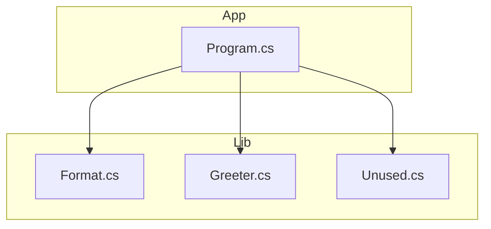

<!-- repo-map:no-verification -->
<!-- GENERATED FILE -- do not edit by hand.
     Regenerate with `repo-tools map`. -->

# cs-repo - Dependency Graph

**Version**: unknown

This document provides a comprehensive dependency graph of all files, components, imports, functions, and variables in the codebase.

---

## Table of Contents

1. [Overview](#overview)
2. [Package Dependencies](#package-dependencies)
3. [App Dependencies](#app-dependencies)
4. [Lib Dependencies](#lib-dependencies)
5. [Dependency Matrix](#dependency-matrix)
6. [Circular Dependency Analysis](#circular-dependency-analysis)
7. [Visual Dependency Graph](#visual-dependency-graph)
8. [Summary Statistics](#summary-statistics)

---

## Overview

The codebase is organized into the following modules:

- **App**: 1 file
- **Lib**: 3 files

---

## App Dependencies

### `src/App/Program.cs` - Program.cs module

**Internal Dependencies:**
| File | Imports | Type |
|------|---------|------|
| `Lib` | `` | Import |
| `Lib` | `` | Import |
| `Lib` | `` | Import |

**Exports:**

---

## Lib Dependencies

### `src/Lib/Format.cs` - Format.cs module

---

### `src/Lib/Greeter.cs` - Greeter.cs module

**Exports:**

---

### `src/Lib/Unused.cs` - Unused.cs module

**Exports:**

---

## Dependency Matrix

### File Import/Export Matrix

| File | Imports From | Exports To |
|------|--------------|------------|
| `src/App/Program.cs` | 1 file | 0 files |
| `src/Lib/Format.cs` | 0 files | 1 file |
| `src/Lib/Greeter.cs` | 0 files | 1 file |
| `src/Lib/Unused.cs` | 0 files | 1 file |

---

## Circular Dependency Analysis

**No circular dependencies detected.**
---

## Visual Dependency Graph

---

## Summary Statistics

| Category | Count |
|----------|-------|
| Total Source Files | 4 |
| Subsystems | 2 |
| Total Lines of Code | 25 |
| Total Exports | 3 |
| Type-only Imports | 0 |
| Runtime Cyclic Components | 0 |
| Type-only Cyclic Components | 0 |
| Files in Runtime Cycles | 0 |
| Files in Type-only Cycles | 0 |

---

*Version*: unknown
