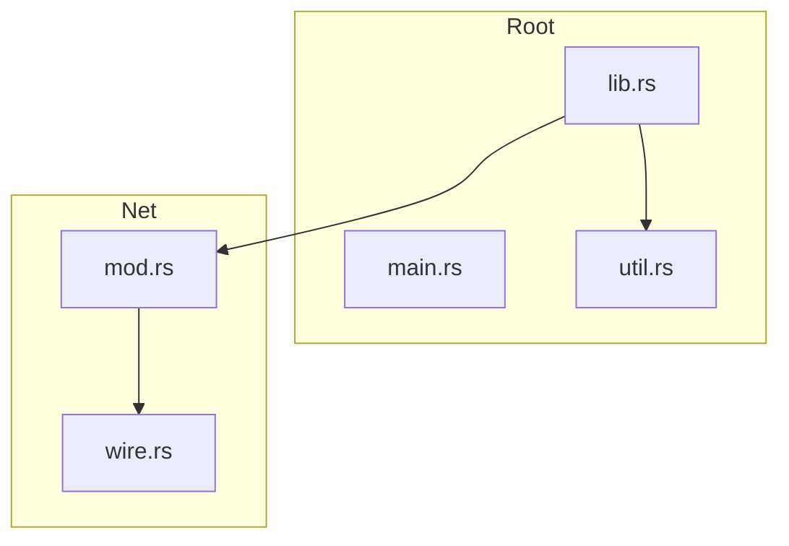

<!-- repo-map:no-verification -->
<!-- GENERATED FILE -- do not edit by hand.
     Regenerate with `repo-tools map`. -->

# rs-repo - Dependency Graph

**Version**: unknown

This document provides a comprehensive dependency graph of all files, components, imports, functions, and variables in the codebase.

---

## Table of Contents

1. [Overview](#overview)
2. [Package Dependencies](#package-dependencies)
3. [Root Dependencies](#root-dependencies)
4. [Net Dependencies](#net-dependencies)
5. [Dependency Matrix](#dependency-matrix)
6. [Circular Dependency Analysis](#circular-dependency-analysis)
7. [Visual Dependency Graph](#visual-dependency-graph)
8. [Summary Statistics](#summary-statistics)

---

## Overview

The codebase is organized into the following modules:

- **root**: 3 files
- **net**: 2 files

---

## Root Dependencies

### `src/lib.rs` - lib.rs module

**Internal Dependencies:**
| File | Imports | Type |
|------|---------|------|
| `./net/mod.rs` | `` | Import |
| `./util.rs` | `` | Import |

**Exports:**

---

### `src/main.rs` - main.rs module

---

### `src/util.rs` - util.rs module

---

## Net Dependencies

### `src/net/mod.rs` - mod.rs module

**Internal Dependencies:**
| File | Imports | Type |
|------|---------|------|
| `./wire.rs` | `` | Import |

**Exports:**

---

### `src/net/wire.rs` - wire.rs module

---

## Dependency Matrix

### File Import/Export Matrix

| File | Imports From | Exports To |
|------|--------------|------------|
| `src/lib.rs` | 2 files | 0 files |
| `src/net/mod.rs` | 1 file | 1 file |
| `src/net/wire.rs` | 0 files | 1 file |
| `src/util.rs` | 0 files | 1 file |
| `src/main.rs` | 0 files | 0 files |

---

## Circular Dependency Analysis

**No circular dependencies detected.**
---

## Visual Dependency Graph

---

## Summary Statistics

| Category | Count |
|----------|-------|
| Total Source Files | 5 |
| Subsystems | 2 |
| Total Lines of Code | 25 |
| Total Exports | 3 |
| Type-only Imports | 0 |
| Runtime Cyclic Components | 0 |
| Type-only Cyclic Components | 0 |
| Files in Runtime Cycles | 0 |
| Files in Type-only Cycles | 0 |

---

*Version*: unknown
